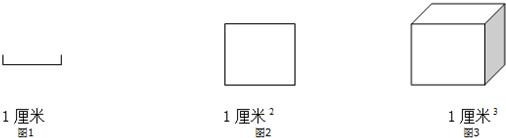

# Mathematics (Grade 5)

**ID**: 7953d228
**难度**: medium_hard
**题型**: fill_in_the_blank

## 题目
说一说，分别是哪种计量单位．

如图1，$\underline{\hspace{5em}}$单位；如图2，$\underline{\hspace{5em}}$单位；如图3，$\underline{\hspace{5em}}$单位．

## 解答

**答案**: 长度, 面积, 体积

1. Step1:观察图1，其标注为1厘米，厘米是用于衡量线段长短等的单位，所以图1是长度单位
2. Step2:观察图2，其标注为1平方厘米，平方厘米是用于衡量平面图形大小的单位，所以图2是面积单位
3. Step3:观察图3，其标注为1立方厘米，立方厘米是用于衡量立体图形所占空间大小的单位，所以图3是体积单位

## 知识点

**知识点**:
  - 长度及长度的常用单位；面积和面积单位；体积、容积及其单位．

---
