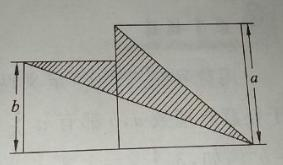

# Mathematics (Grade 5)

**ID**: 7daf8941
**难度**: medium_hard
**题型**: fill_in_the_blank

## 题目
如图，大小正方形的边长分别为a，b，则阴影部分的面积为______ .

 a，b

## 解答

**答案**: $\frac{1}{2}$a−b)^{2}

1. Step1:明确阴影部分面积的计算方法为阴影部分面积=大正方形面积+小正方形面积-右上角空白三角形面积-左下角空白三角形面积
2. Step2:分别计算各部分面积，大正方形面积为a**2，小正方形面积为b**2，右上角空白三角形面积为1/2*b*(a + b)，左下角空白三角形面积为1/2*a*a
3. Step3:列出阴影部分面积的表达式为a**2 + b**2 - 1/2*b*(a + b) - 1/2*a*a
4. Step4:对表达式进行展开：a**2 + b**2 - 1/2*ab - 1/2*b**2 - 1/2*a**2
5. Step5:合并同类项，得到1/2*a**2 - ab + 1/2*b**2
6. Step6:进一步变形为1/2*(a - b)**2

## 知识点

**知识点**:
  - --

---
