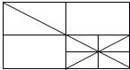

# Mathematics (Grade 5)

**ID**: 7ef9f43f
**难度**: medium_hard
**题型**: fill_in_the_blank

## 题目
数一数，图中有$\underline{\hspace{5em}}$个直角三角形．

## 解答

**答案**: 16

1. Step1:确定以最小的三角形面积为1个单位
2. Step2:数出面积为1的直角三角形有8个
3. Step3:数出面积为4的直角三角形有6个
4. Step4:数出面积为16的直角三角形有2个
5. Step5:将不同面积的直角三角形个数相加，即8 + 6 + 2 = 16个，得到直角三角形总数

## 知识点

**知识点**:
  - 组合图形的计数．

---
