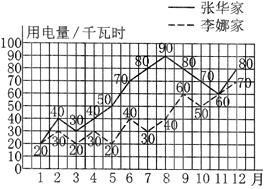

# Mathematics (Grade 5)

**ID**: 867ef421
**难度**: medium_hard
**题型**: fill_in_the_blank

## 题目
下图是张华家和李娜家2016年用电量情况统计图。

（1）这是一张（_____）统计图，纵轴上每一格表示（_____）千瓦时。
（2）张华家用电最多的是在（_____）月，李娜家用电最多的是在（_____）月，用电最多的月份两家相差（_____）千瓦时。
（3）两家用电同样多的是在（_____）月和（_____）月。
（4）6月两家用电相差（_____）千瓦时，10月两家用电相差（_____）千瓦时。
（5）张华家平均每月用电（_____）千瓦时。（得数保留两位小数）
（6）李娜家平均每月用电（_____）千瓦时。（得数保留两位小数）

## 解答

**答案**: 复式折线, 10, 8, 12, 20, 1, 11, 30, 20, 59.17, 39.17

1. Step1:观察统计图可知，这是一张复式折线统计图，从纵轴刻度能看出每一格表示10千瓦时
2. Step2:查看张华家用电量折线，最高点对应的是8月，所以张华家用电最多的是在8月；查看李娜家用电量折线，最高点对应的是12月，所以李娜家用电最多的是在12月
3. Step3:张华家8月用电量为90千瓦时，李娜家12月用电量为80千瓦时，用电最多的月份两家相差90 - 80 = 10千瓦时
4. Step4:观察统计图，发现两家用电同样多的是在1月和11月
5. Step5:6月张华家用电量为70千瓦时，李娜家用电量为40千瓦时，6月两家用电相差70 - 40 = 30千瓦时
6. Step6:10月张华家用电量为70千瓦时，李娜家用电量为50千瓦时，10月两家用电相差70 - 50 = 20千瓦时
7. Step7:计算张华家全年用电量：(20 + 30 + 35 + 40 + 45 + 70 + 80 + 90 + 80 + 70 + 60 + 70) = 710千瓦时，一年12个月，张华家平均每月用电710÷12≈59.17千瓦时
8. Step8:计算李娜家全年用电量：(20 + 30 + 20 + 30 + 40 + 40 + 30 + 60 + 50 + 70 + 80 + 80) = 470千瓦时，李娜家平均每月用电470÷12≈39.17千瓦时

## 知识点

**知识点**:
  - 小学数学;统计和概率;统计;统计图;复式折线统计图

---
