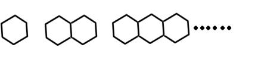

# Mathematics (Grade 5)

**ID**: 9ac3b82d
**难度**: medium_hard
**题型**: fill_in_the_blank

## 题目
用小棒按如下方式摆图形。

$\begin{array}{|c|c|c|c|c|c|c|c|}
\hline
六边形/个
 & 1
 & 2
 & 3
 & 4
 & 5
 & …
 & n
 \\\hline
小棒/根
 & 6
 & 11
 & 16
 & 21
 & 26
 & …
 & 5n+1
 \\\hline
\end{array}$
照这样摆下去。
(1)摆12个六边形需要（______）根小棒。
(2)当n=20时，小棒的根数是（______）。
(3)156根小棒可以摆（______）个六边形。

## 解答

**答案**: 61, 101, 31

1. Step1:根据表格规律，摆$n$个六边形需要$5n + 1$根小棒。对于摆$12$个六边形，将$n = 12$代入$5n + 1$，可得$5×12 + 1 = 60 + 1 = 61$。
2. Step2:当$n = 20$时，把$n = 20$代入$5n + 1$，即$5×20 + 1 = 100 + 1 = 101$。
3. Step3:已知小棒有$156$根，设可以摆$x$个六边形，根据规律列出方程$5x + 1 = 156$，解方程$5x = 156 - 1 = 155$，则$x = 155÷5 = 31$。

## 知识点

**知识点**:
  - 小学数学;数与代数;应用题;常见的数学问题;数与形

---
