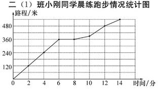

# Mathematics (Grade 5)

**ID**: a198352e
**难度**: medium_hard
**题型**: fill_in_the_blank

## 题目
看统计图回答问题。

（1）休息前，小刚匀速跑了（）分钟。
（2）小刚途中休息了（）分钟。
（3）小刚一共跑了（）米，平均每分钟跑（）米。（保留整数）

## 解答

**答案**: 6, 2, 540, 39

1. Step1:观察统计图，从横轴时间可知，休息前小刚匀速跑的时间是从0分钟到6分钟，所以休息前小刚匀速跑了6分钟
2. Step2:从统计图中可看到，在6分钟到8分钟路程没有变化，说明这期间小刚在休息，8 - 6 = 2，所以小刚途中休息了2分钟
3. Step3:观察统计图可知，休息前跑了360米，休息后又跑了180米，360 + 180 = 540，所以小刚一共跑了540米
4. Step4:已知小刚一共跑了540米，总用时14分钟，根据速度=路程÷时间，540÷14≈39（米），所以平均每分钟跑39米

## 知识点

**知识点**:
  - 从统计图表中获取信息;单式折线统计图

---
