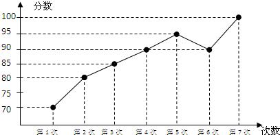

# Mathematics (Grade 5)

**ID**: a694c4f0
**难度**: medium_hard
**题型**: fill_in_the_blank

## 题目
如图是五（1）班某位同学六次数学测验成绩统计图．

①这位同学考的最高分是 $\underline{\hspace{5em}}$ 分，最低分是 $\underline{\hspace{5em}}$ 分．它们相差 $\underline{\hspace{5em}}$ 分．
②从图中可以看出这位同学的成绩是呈 $\underline{\hspace{5em}}$ 趋势．

## 解答

**答案**: 100, 70, 30, 上升

1. Step1:观察统计图，找到分数的最高点对应的分数，得出最高分是100分
2. Step2:观察统计图，找到分数的最低点对应的分数，得出最低分是70分
3. Step3:用最高分100分减去最低分70分，计算出相差30分
4. Step4:观察统计图中分数曲线的变化，得出成绩呈上升趋势

## 知识点

**知识点**:
  - 单式折线统计图

---
