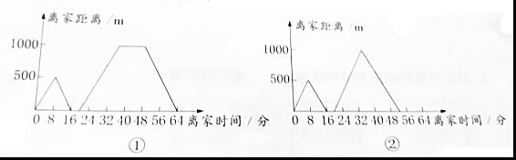

# Mathematics (Grade 5)

**ID**: aaa222d1
**难度**: medium_hard
**题型**: fill_in_the_blank

## 题目
小明从家出发去离家1000m远的书店买书，当他走了8分钟，走了大约一半路程时，想起忘了带钱，于是他返回家取钱．他取钱用了4分钟，然后再去书店，买了几本书后回家．小明在来回的路上都是匀速行走，他在书店共待了12分钟，如图，能反映小明行程的图是$\underline{\hspace{5em}}$      （填序号）

## 解答

**答案**: ①

1. Step1:小明出发走8分钟到大约一半路程处，此时离家距离从0增加到约500m，对应图像是离家距离随时间增加而增大的线段。
2. Step2:小明想起忘带钱返回家，此时离家距离从约500m减小到0m，对应图像是离家距离随时间减小的线段。
3. Step3:小明取钱用4分钟，这期间离家距离为0m，对应图像是一段水平线段。
4. Step4:小明再次出发去书店，此时离家距离从0m增加到1000m，对应图像是离家距离随时间增加而增大的线段。
5. Step5:小明在书店待12分钟，这期间离家距离一直是1000m，对应图像是一段水平线段。
6. Step6:小明从书店回家，此时离家距离从1000m减小到0m，对应图像是离家距离随时间减小的线段。
7. Step7:综合上述行程分析，符合此行程的图像是①。

## 知识点

**知识点**:
  - 从统计图表中获取信息;单式折线统计图

---
