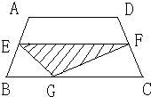

# Mathematics (Grade 5)

**ID**: ac4efdc0
**难度**: medium_hard
**题型**: fill_in_the_blank

## 题目
如图，E、F分别是梯形ABCD两腰上的中点，已知阴影部分的面积是43c㎡，那么梯形ABCD的面积是$\underline{\hspace{5em}}$c㎡．

## 解答

**答案**: 172

1. Step1:因为E、F分别是梯形ABCD两腰上的中点，所以EF是梯形ABCD的中位线，可得EF = $rac{1}{2}$（AD + BC）
2. Step2:因为三角形GFE底EF上的高是梯形高的$rac{1}{2}$
3. Step3:根据上述条件可知梯形ABCD的面积相当于一个底和高都是三角形GFE 2倍的三角形的面积
4. Step4:根据三角形面积公式，底和高都变为原来2倍时，面积变为原来2×2 = 4倍
5. Step5:已知阴影部分（三角形GFE）面积是43c㎡，所以梯形ABCD面积为43×4 = 172c㎡

## 知识点

**知识点**:
  - 组合图形的面积．

---
