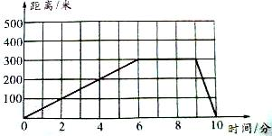

# Mathematics (Grade 5)

**ID**: ae040d5b
**难度**: medium_hard
**题型**: fill_in_the_blank

## 题目
星期天小明步行去商场买文具，买好后乘公共汽车回家，他的行程如下图：
（1）小明步行每分钟行(    )米．
（2）在商场里买东西花了(    )分钟．
（3）公共汽车每分钟行(    )米．

## 解答

**答案**: 50, 3, 300

1. Step1:根据折线统计图可知，小明步行时间为6分钟，行走路程为300米，由公式路程÷时间=速度，可得小明步行速度为300÷6 = 50米/分钟
2. Step2:小明在第6分钟到达商场，第9分钟离开商场，所以在商场里买东西花的时间为9 - 6 = 3分钟
3. Step3:公共汽车行驶时间为10 - 9 = 1分钟，行驶路程为300米，根据公式路程÷时间=速度，可知公共汽车速度为300÷1 = 300米/分钟

## 知识点

**知识点**:
  - 单式折线统计图；从统计图表中获取信息．

---
