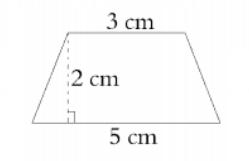

# Mathematics (Grade 5)

**ID**: aed0436d
**难度**: medium_hard
**题型**: fill_in_the_blank

## 题目
如图所示， 在这个梯形内画一个面积最大的三角形，这个三角形的面积是（）cm$^{2}$。

## 解答

**答案**: 5

1. Step1:根据题意可知，在梯形内画面积最大的三角形，是以梯形较长底边为底，与梯形等高的三角形，此梯形较长底边为5厘米，高为2厘米
2. Step2:根据三角形面积公式：三角形面积=底×高÷2，将底5厘米和高2厘米代入公式，即计算5×2÷2
3. Step3:得出5×2÷2的结果为5平方厘米，所以这个三角形面积是5平方厘米

## 知识点

**知识点**:
  - 三角形的面积;梯形的面积

---
