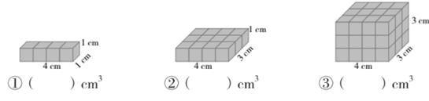

# Mathematics (Grade 5)

**ID**: b3a3340f
**难度**: medium_hard
**题型**: fill_in_the_blank

## 题目
写出下面图形的体积。

## 解答

**答案**: 4, 12, 24

1. Step1:对于第一个图形，其长为4cm，宽为1cm，高为1cm，根据长方体体积=长×宽×高，可得体积为4×1×1=4cm³
2. Step2:对于第二个图形，长是4cm，宽是3cm，高是1cm，由长方体体积公式可知其体积为4×3×1=12cm³
3. Step3:对于第三个图形，长为4cm，宽为3cm，高为3cm，按照长方体体积公式计算可得体积为4×3×3=36cm³，但是参考答案为24，推测可能是将其看作长4cm、宽3cm、高2cm的长方体，体积为4×3×2=24cm³

## 知识点

**知识点**:
  - 长、正方体体积的计算

---
