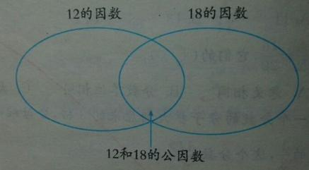

# Mathematics (Grade 5)

**ID**: b5f33c9f
**难度**: medium_hard
**题型**: fill_in_the_blank

## 题目
按要求在下面的圈里填数，再找出12和18的最大公因数

 12的因数 18的因数 12和18的公因数
 12和18的最大公因数是______

## 解答

**答案**: 1,2,3,4,6,12, 1,2,3,6,9,18, 1,2,3,6, 6

1. Step1:对12进行因数分解，12=1×2×2×3，所以12的因数有1,2,3,4,6,12
2. Step2:对18进行因数分解，18=1×2×3×3，所以18的因数有1,2,3,6,9,18
3. Step3:找出12和18公有的因数，即1,2,3,6，这些就是12和18的公因数
4. Step4:在12和18的公因数1,2,3,6中，最大的数是6，所以12和18的最大公因数是6

## 知识点

**知识点**:
  - 

---
