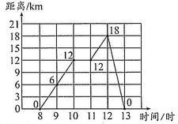

# Mathematics (Grade 5)

**ID**: b7ec042b
**难度**: medium_hard
**题型**: fill_in_the_blank

## 题目
下面的折线统计图表示的是李老师从8时到13时由家到动物园并返回家骑车行驶的情况

 （1）李老师的家到动物园全长（   ）千米
 （2）李老师途中有没有停留？如果停留过，停留了多长时间？
 （3）李老师从家到动物园用了（   ）小时
 （4）李老师从动物园回家用了（   ）小时

## 解答

**答案**: 18, 1小时, 4小时, 1小时

1. Step1:观察折线统计图，找到最高点对应的距离值为18千米，此即为李老师的家到动物园全长
2. Step2:观察折线统计图，发现10时至11时距离没有变化，所以李老师途中有停留，停留时间为11 - 10 = 1小时
3. Step3:从图中可知李老师8时出发，12时到达动物园，从家到动物园所用时间为12 - 8 = 4小时
4. Step4:李老师12时从动物园出发，13时到家，从动物园回家所用时间为13 - 12 = 1小时

## 知识点

**知识点**:
  - 折线统计图-单式折线统计图
-

---
