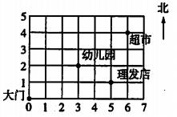

# Mathematics (Grade 5)

**ID**: b8fe033d
**难度**: medium_hard
**题型**: fill_in_the_blank

## 题目
下图是宝安小区的平面图。

(1)大门的位置是_________；
(2)幼儿园的位置是_________；  
(3)理发店的位置是_________； 
(4)超市的位置是_______；   
(5)幼儿园在理发店的（_______）方向；   
(6)超市在理发店的（_______）方向。

## 解答

**答案**: (0，0), (3，2), (5，1), (6，4), 西北, 东北

1. Step1:根据数对表示位置先列后行的方法，大门在第0列第0行，所以大门的位置是(0，0)
2. Step2:幼儿园在第3列第2行，所以幼儿园的位置是(3，2)
3. Step3:理发店在第5列第1行，所以理发店的位置是(5，1)
4. Step4:超市在第6列第4行，所以超市的位置是(6，4)
5. Step5:以理发店为观测点，幼儿园在理发店的左上方，根据上北下南左西右东，可知幼儿园在理发店的西北方向
6. Step6:以理发店为观测点，超市在理发店的右上方，所以超市在理发店的东北方向

## 知识点

**知识点**:
  - 

---
