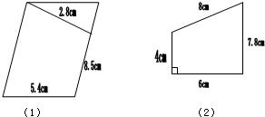

# Mathematics (Grade 5)

**ID**: bf49bbdf
**难度**: medium_hard
**题型**: fill_in_the_blank

## 题目
计算下面图形的面积．

(1)______；
(2)______．

## 解答

**答案**: 23.8, 35.4

1. Step1:根据平行四边形面积公式，找到底为8.5厘米，高为2.8厘米，计算面积为8.5×2.8=23.8平方厘米
2. Step2:根据梯形面积公式，找到上底为4厘米，下底为7.8厘米，高为6厘米，先计算4 + 7.8 = 11.8厘米，再计算11.8×6 = 70.8平方厘米，最后计算70.8÷2 = 35.4平方厘米

## 知识点

**知识点**:
  - 平行四边形的面积;梯形的面积．

---
