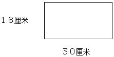

# Mathematics (Grade 5)

**ID**: c18776d9
**难度**: medium_hard
**题型**: fill_in_the_blank

## 题目
如图，把这个长方形正好分成一些小正方形，小正方形的边长最大是$\underline{\hspace{5em}}$      厘米．

## 解答

**答案**: 6

1. Step1:明确问题是求长方形长30厘米和宽18厘米的最大公因数
2. Step2:将30分解质因数为30=2×3×5
3. Step3:将18分解质因数为18=2×3×3
4. Step4:找出30和18公有的质因数为2和3
5. Step5:计算公有质因数的乘积2×3=6，得出最大公因数为6，即小正方形边长最大是6厘米

## 知识点

**知识点**:
  - 公因数和公倍数应用题

---
