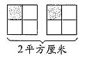

# Mathematics (Grade 5)

**ID**: c5e35f52
**难度**: medium_hard
**题型**: fill_in_the_blank

## 题目
把2个1平方厘米的正方形平均分成4份，每份是2个
 $\frac{1}{（\,\,\,\,）}$
  平方厘米，是
  $\frac{（\,\,\,\,）}{（\,\,\,\,）}$
   平方厘米。

 2

## 解答

**答案**: 4, 1, 2

1. Step1:已知有2个1平方厘米的正方形，要将它们平均分成4份
2. Step2:根据分数的意义，把1个正方形平均分成4份，每份是1个$rac{1}{4}$平方厘米，那么平均分成4份后，每份是2个$rac{1}{4}$平方厘米
3. Step3:计算2个$rac{1}{4}$平方厘米是多少，即$rac{1}{4}+rac{1}{4}=rac{1}{2}$平方厘米
4. Step4:得出第一个空应填4，第二个空应填1，第三个空应填2

## 知识点

**知识点**:
  - 分数的意义和性质

---
