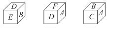

# Mathematics (Grade 5)

**ID**: d28c4aea
**难度**: medium_hard
**题型**: fill_in_the_blank

## 题目
一个正方体的6个面分别写有A、B、C、D、E、F，根据下面3种摆放情况，判断每个字母对面的字母是什么。

## 解答

**答案**: C, E, F

1. Step1:观察前两个图，找出与D相邻的面，分别为A、B、E、F，由于正方体共有6个面，所以D对面的字母是除了这四个相邻面字母外剩下的C
2. Step2:观察第一个图和第三个图，找出与A相邻的面，分别为B、C、D、F，所以A对面的字母是除了这四个相邻面字母外剩下的E
3. Step3:已知D对面是C，A对面是E，那么剩下的B对面就是F

## 知识点

**知识点**:
  - 长、正方体的展开与折叠

---
