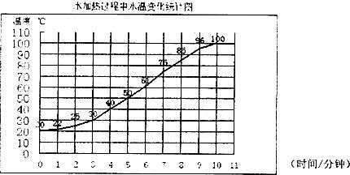

# Mathematics (Grade 5)

**ID**: d8063883
**难度**: medium_hard
**题型**: fill_in_the_blank

## 题目
如图是王刚在烧一壶水时的温度变化情况统计图，请观察图后填写．
（1）未加热时水温是$\underline{\hspace{5em}}$℃；（2）加热6分钟时，水温是$\underline{\hspace{5em}}$℃；
（3）加热到85℃时用了$\underline{\hspace{5em}}$分钟；（4）烧开这壶水用了$\underline{\hspace{5em}}$分钟．

## 解答

**答案**: 20, 60, 8, 10

1. Step1:观察折线统计图，找到横轴为0分钟对应的纵轴水温，得出未加热时水温是20℃
2. Step2:观察折线统计图，找到横轴为6分钟对应的纵轴水温，得出加热6分钟时，水温是60℃
3. Step3:观察折线统计图，找到纵轴为85℃对应的横轴时间，得出加热到85℃时用了8分钟
4. Step4:观察折线统计图，找到水温达到100℃（水烧开的温度）时对应的横轴时间，得出烧开这壶水用了10分钟

## 知识点

**知识点**:
  - 单式折线统计图；从统计图表中获取信息．

---
