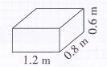

# Mathematics (Grade 5)

**ID**: daf71357
**难度**: medium_hard
**题型**: fill_in_the_blank

## 题目
填空。

（1） 上、下每个面，长（____），宽（____），面积是（____）。
（2） 前、后每个面，长（____），宽（____），面积是（____）。
（3） 左、右每个面，长（____），宽（____），面积是（____）。
（4） 这个长方体的表面积是（_____）。

## 解答

**答案**: 1.2m, 0.8m, 0.96m^2, 1.2m, 0.6m, 0.72m^2, 0.8m, 0.6m, 0.48m^2, 4.32 m^2

1. Step1:根据长方体的特征，上、下每个面的长是长方体的长，即1.2m，宽是长方体的宽，即0.8m，根据长方形面积公式S = 长×宽，可得面积为1.2×0.8 = 0.96m²
2. Step2:前、后每个面的长是长方体的长，即1.2m，宽是长方体的高，即0.6m，根据长方形面积公式可得面积为1.2×0.6 = 0.72m²
3. Step3:左、右每个面的长是长方体的宽，即0.8m，宽是长方体的高，即0.6m，根据长方形面积公式可得面积为0.8×0.6 = 0.48m²
4. Step4:长方体表面积 = （上面面积 + 前面面积 + 左面面积）×2 = （0.96 + 0.72 + 0.48）×2 = 4.32m²
5. Step5:将上述各面的长、宽、面积以及长方体表面积按题目顺序整理成列表

## 知识点

**知识点**:
  - 

---
