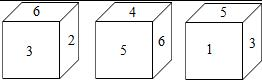

# Mathematics (Grade 5)

**ID**: e0efb90c
**难度**: medium_hard
**题型**: fill_in_the_blank

## 题目
一个正方体的六个面上分别写着1至6六个数，下面是这个正方体的三种摆放位置．3的对面是$\underline{\hspace{5em}}$，6的对面是$\underline{\hspace{5em}}$．

## 解答

**答案**: 4, 1

1. Step1:观察图1和图2，发现与6相邻的四个面分别是2、3、4、5，所以6的对面不是2、3、4、5，只能是1
2. Step2:观察图2和图3，发现与5相邻的四个面分别是1、3、4、6，所以5的对面不是1、3、4、6，只能是2
3. Step3:因为已经确定1和6相对，2和5相对，那么剩下的3的对面就是4

## 知识点

**知识点**:
  - 正方体的展开图．

---
