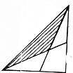

# Mathematics (Grade 5)

**ID**: e234cfa4
**难度**: medium_hard
**题型**: fill_in_the_blank

## 题目
如图所示，由两条直角边分别为3厘米和7厘米的两个同样大小的直角三角形，则阴影部分的面积为 $\underline{\hspace{5em}}$ 平方厘米．

## 解答

**答案**: 14

1. Step1:根据题目可知，两个直角三角形同样大小，阴影部分是一个三角形，其底为大直角三角形的直角边减去小直角三角形的直角边，即7 - 3 = 4厘米
2. Step2:确定阴影部分三角形的高为大直角三角形的直角边，即7厘米
3. Step3:根据三角形面积公式s = ah÷2（其中a为底，h为高），将底4厘米和高7厘米代入公式，可得面积为4×7÷2
4. Step4:计算4×7÷2 = 28÷2 = 14平方厘米

## 知识点

**知识点**:
  - 组合图形的面积

---
