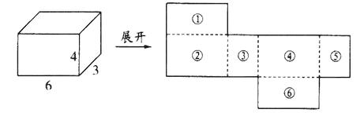

# Mathematics (Grade 5)

**ID**: eed059db
**难度**: medium_hard
**题型**: fill_in_the_blank

## 题目
下图是一个长方体的展开图，找出相对的两个面，并说一说它们是长方体的哪几个面？（单位：m）

相对的面是（_______）号和（_______）号，（_______）号和（_______）号以及（_______）号和（_______）号。
其中（_______）号和（_______）号是长方体的上、下面，（_______）号和（_______）号是长方体的前，后面，（______）号和（_______）号是长方体的左、右面。

## 解答

**答案**: 2, 4, 1, 6, 3, 5, 6, 1, 4, 2, 3, 5

1. Step1:观察长方体展开图的特征，相对的面在展开图中不相邻。
2. Step2:根据展开图可知，①号和⑥号是相对的面，②号和④号是相对的面，③号和⑤号是相对的面。
3. Step3:确定长方体的上、下面，通常上下面的形状与其他面有一定区别，这里⑥号和①号可作为上、下面。
4. Step4:确定长方体的前、后面，④号和②号可作为前、后面。
5. Step5:确定长方体的左、右面，③号和⑤号可作为左、右面。
6. Step6:将对应数字填入题目空格，得到相对的面是（2）号和（4）号，（1）号和（6）号以及（3）号和（5）号。其中（6）号和（1）号是长方体的上、下面，（4）号和（2）号是长方体的前、后面，（3）号和（5）号是长方体的左、右面。

## 知识点

**知识点**:
  - 

---
