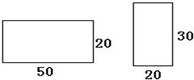

# Mathematics (Grade 5)

**ID**: f2025ba5
**难度**: medium_hard
**题型**: fill_in_the_blank

## 题目
有一个无盖长方体玻璃鱼缸，侧面四块用玻璃（其中两块如图，单位：厘米），底面用铁皮．铁皮的面积是 $\underline{\hspace{5em}}$ 平方厘米，这个鱼缸的高是 $\underline{\hspace{5em}}$ 厘米．

## 解答

**答案**: 1000, 30

1. Step1:观察给出的两块侧面图形，确定长方体鱼缸的长是50厘米，宽是20厘米，高是30厘米
2. Step2:因为底面用铁皮，所以铁皮为长50厘米、宽20厘米的长方形
3. Step3:根据长方形面积公式，计算铁皮面积为50×20 = 1000平方厘米
4. Step4:得出铁皮的面积是1000平方厘米，鱼缸的高是30厘米

## 知识点

**知识点**:
  - 长方体和正方体的表面积

---
