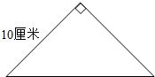

# Mathematics (Grade 5)

**ID**: fd6ca692
**难度**: medium_hard
**题型**: fill_in_the_blank

## 题目
如图是一个等腰三角形，它的一个底角是$\underline{\hspace{5em}}$度，面积是$\underline{\hspace{5em}}$平方厘米．

## 解答

**答案**: 45, 50

1. Step1:根据等腰直角三角形的性质，已知顶角是90°，因为等腰三角形两底角相等，所以底角为90÷2=45°
2. Step2:此等腰直角三角形直角边为10厘米，根据三角形面积公式，面积是两个直角边的乘积的一半，即10×10÷2=50平方厘米

## 知识点

**知识点**:
  - 三角形的周长和面积；三角形的内角和；角的度量．

---
