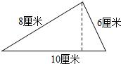

# Mathematics (Grade 5)

**ID**: fe3e83b0
**难度**: medium_hard
**题型**: fill_in_the_blank

## 题目
如图中直角三角形斜边上的高是$\underline{\hspace{5em}}$厘米．

## 解答

**答案**: 4.8

1. Step1:根据直角三角形面积等于两条直角边乘积的一半，先计算两条直角边8厘米和6厘米的乘积，即8×6
2. Step2:将上一步的结果除以2，得到直角三角形的面积，即8×6÷2
3. Step3:将求出的面积乘2，即8×6÷2×2
4. Step4:用面积乘2后的结果除以斜边10厘米，即8×6÷2×2÷10，得到斜边上的高为4.8厘米

## 知识点

**知识点**:
  - 三角形的周长和面积．

---
