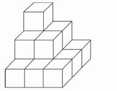

# Mathematics (Grade 5)

**ID**: ffcea87e
**难度**: medium_hard
**题型**: fill_in_the_blank

## 题目
附加题。
将14个大小一样的小正方体摆成下面的图形，然后将表面涂成红色再分开，有（）个小正方形的面没有被涂色。

## 解答

**答案**: 42

1. Step1:计算14个小正方体总共的面数，因为每个小正方体有6个面，所以总共面数为14×6=84个
2. Step2:计算立体图形中被涂色的面数，分别计算不同位置的面数并相加，得到6×4+9×2=42个
3. Step3:用总共的面数减去被涂色的面数，即84 - 42 = 42个，得出没有被涂色的面数

## 知识点

**知识点**:
  - 不规则立体图形表面积的计算(奥数)

---
