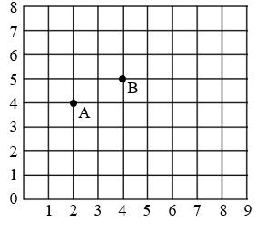

# Mathematics (Grade 5)

**ID**: 00f2c71c
**难度**: medium_hard
**题型**: multiple_choice

## 题目
如图，如果点A的位置表示为（2，4），则点B的位置可以表示为（    ）。 

$\begin{description}
\item A.（4，4）\item B.（4，5）\item C.（5，4）\item D.（3，3）
\end{description}$

## 解答

**答案**: B

1. Step1:明确数对的表示方法为（列数，行数），数对的第一个数表示列，第二个数表示行
2. Step2:观察图形，确定点B所在的列数为4
3. Step3:观察图形，确定点B所在的行数为5
4. Step4:根据数对表示方法，得出点B的位置用数对表示为（4，5）

## 知识点

**知识点**:
  - 

---
