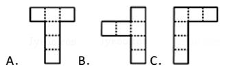

# Mathematics (Grade 5)

**ID**: 05547f1a
**难度**: medium_hard
**题型**: multiple_choice

## 题目
图形中，沿虚线折叠后能围成正方体的是（）

## 解答

**答案**: A

1. Step1:明确本题考点为正方体的展开和折叠，关键在于掌握正方体的特征
2. Step2:分析选项A，发现其满足正方体11种展开图中的‘1-4-1’型
3. Step3:分析选项B和C，得出折叠起来会有重复的面
4. Step4:综上，能沿虚线折叠后围成正方体的是A

## 知识点

**知识点**:
  - 长、正方体的展开与折叠

---
