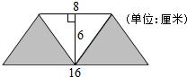

# Mathematics (Grade 5)

**ID**: 0879cead
**难度**: medium_hard
**题型**: multiple_choice

## 题目
阴影部分的面积是 （  ）平方厘米．

$\begin{description}
\item A．48\item B．96\item C．40\item D．60
\end{description}$

## 解答

**答案**: A

1. Step1:明确阴影部分面积的计算方法为梯形面积减去空白三角形面积
2. Step2:根据梯形面积公式S=(a+b)h÷2（其中a=8，b=16，h=6），计算梯形面积为(8 + 16)×6÷2 = 24×6÷2 = 72平方厘米
3. Step3:根据三角形面积公式S=ah÷2（其中a=8，h=6），计算空白三角形面积为8×6÷2 = 24平方厘米
4. Step4:用梯形面积72平方厘米减去空白三角形面积24平方厘米，得到阴影部分面积为72 - 24 = 48平方厘米

## 知识点

**知识点**:
  - 组合图形的面积．

---
