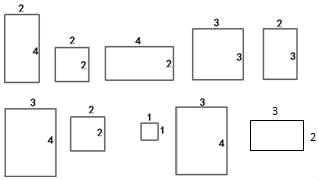

# Mathematics (Grade 5)

**ID**: 0b8e9278
**难度**: medium_hard
**题型**: multiple_choice

## 题目
桌子上放着10张长方形的卡片（如下图，单位：厘米）：

从这些卡片中选出6张，组成长方体．组成的长方体表面积为（  ）平方厘米．
A．36
B．62
C．52

## 解答

**答案**: C

1. Step1:明确要从10张长方形卡片中选6张组成长方体
2. Step2:根据长方体表面积公式S=(ab + ah + bh)×2（其中a、b、h分别为长方体的长、宽、高），这里选取长为4厘米、宽为3厘米、高为2厘米的情况
3. Step3:代入长4厘米、宽3厘米、高2厘米到表面积公式，即计算(4×3 + 4×2 + 3×2)×2
4. Step4:先计算括号内的值，4×3 = 12，4×2 = 8，3×2 = 6，得到(12 + 8 + 6)×2
5. Step5:计算12 + 8 + 6 = 26，得到26×2
6. Step6:计算26×2 = 52平方厘米，所以长方体表面积为52平方厘米，答案选C

## 知识点

**知识点**:
  - 

---
