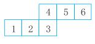

# Mathematics (Grade 5)

**ID**: 134c2a9e
**难度**: medium_hard
**题型**: multiple_choice

## 题目
如图是正方体的平面展开图，每个面都标注了数字，如果2在正方体的左面，3在下面，那么正面的数字是(  )

A.1
B.4
C.5
D.6

## 解答

**答案**: B

1. Step1:明确这是正方体的平面展开图，共有六个面
2. Step2:根据正方体展开图特征，得出面“5”与面“2”相对，面“4”与面“6”相对，“1”与面“3”相对
3. Step3:因为2、3、4所在的面是正方体的邻面，且已知2在正方体的左面，3在下面
4. Step4:所以可推出4在正面
5. Step5:得出正面的数字是4，答案选B

## 知识点

**知识点**:
  - 正方体的展开与折叠

---
