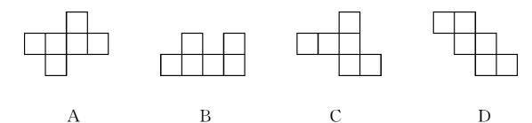

# Mathematics (Grade 5)

**ID**: 1490d293
**难度**: medium_hard
**题型**: multiple_choice

## 题目
选这题；
下面图形中不能围成正方体的是（）。

## 解答

**答案**: B

1. Step1:明确本题关键是利用正方体表面展开图解答，正方体展开图至少有三层
2. Step2:观察选项A，其符合正方体展开图的形式，能够围成正方体
3. Step3:观察选项B，它只有两层，尝试后发现围不了正方体
4. Step4:观察选项C，其符合正方体展开图的形式，能够围成正方体
5. Step5:观察选项D，其符合正方体展开图的形式，能够围成正方体
6. Step6:得出不能围成正方体的是B选项

## 知识点

**知识点**:
  - 正方体的展开与折叠

---
