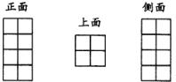

# Mathematics (Grade 5)

**ID**: 190e811b
**难度**: medium_hard
**题型**: multiple_choice

## 题目
用1立方厘米的小正方体摆成一个几何体，从正面、上面和侧面看，分别得到下面的图形．这个几何体是由（  ）个小正方体摆成的．
$\begin{description}
\item A．16\item B．18\item C．20
\end{description}$

## 解答

**答案**: A

1. Step1:从上面看到的图形可知，这个几何体的底层有4个小正方体
2. Step2:从正面看到的图形可知，这个几何体有4层
3. Step3:从侧面看到的图形可知，每层的小正方体个数与底层相同，都是4个
4. Step4:计算小正方体的总数，4×4 = 16个
5. Step5:得出答案为A

## 知识点

**知识点**:
  - 从不同方向观察物体和几何体；简单的立方体切拼问题．

---
