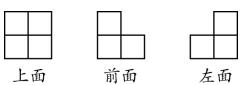

# Mathematics (Grade 5)

**ID**: 197e86ff
**难度**: medium_hard
**题型**: multiple_choice

## 题目
小军用棱长为1cm的正方体摆成一个物体，如图所示是他从几个不同的方向看到的图形，他所摆的物体体积是（）cm$^{3}$。

## 解答

**答案**: 5

1. Step1:根据从正面、左面看到的图形，确定物体有两层，且上层有1个正方体
2. Step2:依据从上面看到的图形，得出下层有4个小正方体
3. Step3:计算正方体总个数，1+4=5个
4. Step4:因为每个小正方体棱长为1cm，体积为1×1×1=1cm³，所以物体体积为1×5=5cm³

## 知识点

**知识点**:
  - 从不同方向观察物体

---
