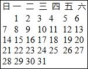

# Mathematics (Grade 5)

**ID**: 1992caa2
**难度**: medium_hard
**题型**: multiple_choice

## 题目
 如图给出的是2004年3月份的日历表，任意圈出一竖列上相邻的三个数，请你研究一下，发现这三个数的和不可能是 （  ）
A．69
B．54
C．40

## 解答

**答案**: C

1. Step1:明确一竖列上相邻三个数的关系，设中间的数是x，上面的数是x - 7，下面的数是x + 7
2. Step2:计算这三个数的和为(x - 7) + x + (x + 7) = 3x
3. Step3:得出这三个数的和一定是3的倍数
4. Step4:判断69÷3=23，69是3的倍数
5. Step5:判断54÷3=18，54是3的倍数
6. Step6:判断40÷3=13......1，40不是3的倍数
7. Step7:得出这三个数的和不可能是40，答案选C

## 知识点

**知识点**:
  - 数表中的规律．

---
