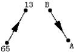

# Mathematics (Grade 5)

**ID**: 206608ef
**难度**: medium_hard
**题型**: multiple_choice

## 题目
图中，65是13的倍数，A是B的（  ）
$\begin{description}
\item A．倍数\item B．因数\item C．合数
\end{description}$

## 解答

**答案**: B

1. Step1:观察图中 65→13 的箭头指向，可知箭头指向 13，65 是 13 的倍数，那么 13 是 65 的因数
2. Step2:观察图中 B→A 的箭头指向，箭头指向 A，根据倍数和因数的关系，当 B 是 A 的倍数时，A 就是 B 的因数
3. Step3:根据上述分析，判断 A 是 B 的因数，所以答案选 B

## 知识点

**知识点**:
  - 因数和倍数的意义．

---
