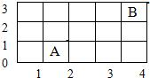

# Mathematics (Grade 5)

**ID**: 210143f7
**难度**: medium_hard
**题型**: multiple_choice

## 题目
如图，如果点A的位置表示为(2，1)，则点B的位置可以表示为(  )
A．(3，5)
B．(5，3)
C．(4，3)
D．(3，4)

## 解答

**答案**: C

1. Step1:由点A的位置(2，1)可知，数对中第一个数表示列，第二个数表示行
2. Step2:观察图形，确定点B在第4列
3. Step3:观察图形，确定点B在第3行
4. Step4:根据数对的表示方法，得出点B的位置用数对表示为(4，3)

## 知识点

**知识点**:
  - 数对与位置．

---
