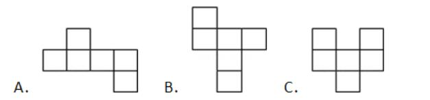

# Mathematics (Grade 5)

**ID**: 2ba15d57
**难度**: medium_hard
**题型**: multiple_choice

## 题目
下列图形都是由相同的小正方形组成，哪一个图形不能折成正方体？（  ）

## 解答

**答案**: C

1. Step1:明确正方体表面展开图有1-4-1型、2-3-1型、3-3型、2-2-2型这四种类型
2. Step2:判断A选项是1-4-1型
3. Step3:判断B选项是2-3-1型
4. Step4:判断C选项不属于上述四种类型
5. Step5:得出C选项不能折成正方体，答案为C

## 知识点

**知识点**:
  - 长、正方体的展开与折叠

---
