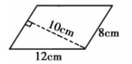

# Mathematics (Grade 5)

**ID**: 31cebead
**难度**: medium_hard
**题型**: multiple_choice

## 题目
计算下图的面积，正确的列式是（）

A.12×10
B.8×10
C.12×8

## 解答

**答案**: B

1. Step1:明确平行四边形面积公式为面积=底×高
2. Step2:观察图形，发现高为10cm，根据平行四边形对边相等，确定与10cm垂直的底边长度是8cm
3. Step3:根据面积公式，代入底为8cm，高为10cm，得出面积列式为8×10，所以答案选B

## 知识点

**知识点**:
  - 

---
