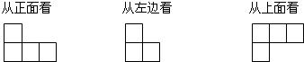

# Mathematics (Grade 5)

**ID**: 355242d5
**难度**: medium_hard
**题型**: multiple_choice

## 题目
如图是由一些相同的小正方形构成的几何体的三视图．
有几个正方体（  ）
$\begin{description}
\item A．4\item B．5\item C．6\item D．7
\end{description}$

## 解答

**答案**: B

1. Step1:根据俯视图可知，该几何体最底层有4个正方体
2. Step2:由主视图可知，该几何体第二层最多有2个正方体
3. Step3:依据左视图可知，该几何体第二层只有1个正方体
4. Step4:计算该几何体正方体的总数，为最底层的4个加上第二层的1个，即4 + 1 = 5个

## 知识点

**知识点**:
  - 三视图与展开图．

---
