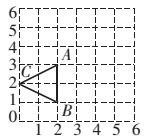

# Mathematics (Grade 5)

**ID**: 36eee434
**难度**: medium_hard
**题型**: multiple_choice

## 题目
如图，如果将三角形ABC向上平移2个单位，再向右平移1个单位，则顶点A的位置应表示为（）。

A.（2，5）
B.（3，5）
C.（3，3）
D.（5，2）

## 解答

**答案**: B

1. Step1:根据图形确定点A原来的位置为（2，3）
2. Step2:向上平移2个单位，根据向上平移数对中第一个数字不变，第二个数字增加2，得到（2，5）
3. Step3:再向右平移1个单位，根据向右平移数对中的第一个数字增加1，第二个数字不变，得到（3，5）
4. Step4:得出顶点A平移后的位置应表示为（3，5），所以答案选B

## 知识点

**知识点**:
  - 在方格纸上画平移后的图形

---
