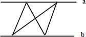

# Mathematics (Grade 5)

**ID**: 391ed2dd
**难度**: medium_hard
**题型**: multiple_choice

## 题目
如图，直线a∥b，则图中面积相等的三角形有(  )对．

A．1对
B．2对
C．3对
D．4对

## 解答

**答案**: C

1. Step1:因为直线a∥b，可知两直线之间的距离处处相等
2. Step2:观察图形，以下边为底的两个三角形，由于它们的底在同一条直线b上，且高是两平行线a、b间的距离，所以这两个三角形等底等高，面积相等
3. Step3:以上边为底的两个三角形，它们的底在同一条直线a上，高同样是两平行线a、b间的距离，所以这两个三角形等底等高，面积也相等
4. Step4:对于中间相对的两个三角形，可通过等积变换，将其转化为等底等高的三角形，从而得出这两个三角形面积相等
5. Step5:综上，图中面积相等的三角形有3对，答案选C

## 知识点

**知识点**:
  - 三角形的周长和面积．

---
