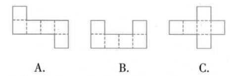

# Mathematics (Grade 5)

**ID**: 3c602774
**难度**: medium_hard
**题型**: multiple_choice

## 题目
下列三个图形中，沿虚线不能折叠成正方体的是（）

## 解答

**答案**: B

1. Step1:明确本题考点是正方体的展开和折叠，关键在于掌握正方体的特征
2. Step2:判断选项A，发现其图形属于正方体11种展开图中的“1-4-1”型，所以可以折叠成正方体
3. Step3:判断选项B，将其图形折叠起来会有重复的面，所以不能折叠成正方体
4. Step4:判断选项C，其图形属于正方体11种展开图中的“1-4-1”型，所以可以折叠成正方体
5. Step5:综上，沿虚线不能折叠成正方体的是B

## 知识点

**知识点**:
  - 长、正方体的展开与折叠

---
