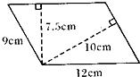

# Mathematics (Grade 5)

**ID**: 3e7e3aef
**难度**: medium_hard
**题型**: multiple_choice

## 题目
计算下面平行四边形面积的正确算式是（  ）

$\begin{description}
\item A．12×10\item B．7.5×12\item C．9×12\item D．7.5×10
\end{description}$

## 解答

**答案**: B

1. Step1:明确平行四边形面积公式为s = ah，其中a为底，h为底对应的高
2. Step2:观察图形，底为12cm时，对应的高是7.5cm
3. Step3:根据公式计算面积，算式为12×7.5，所以答案选B

## 知识点

**知识点**:
  - 平行四边形的面积．

---
