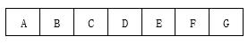

# Mathematics (Grade 5)

**ID**: 3f5cc1d5
**难度**: medium_hard
**题型**: multiple_choice

## 题目
建湖钟庄小学有位老师的小灵通号码设置成了如图的密码：建湖是6开头，B既不是质数也不是合数，C加上1是最小的合数，D是2和3的公倍数，E是最小的质数的4倍，F是质数又是偶数，G是10以内最大的质数。你能破译出这位老师的小灵通号码是（ ）。

$\begin{description}
\item A．6183617\item B．6156817\item C．6136807\item D．6136827
\end{description}$

## 解答

**答案**: D

1. Step1:已知建湖是6开头，所以号码首位是6。
2. Step2:因为B既不是质数也不是合数，所以B = 1。
3. Step3:由于C加上1是最小的合数，最小的合数是4，所以C = 4 - 1 = 3。
4. Step4:因为D是2和3的公倍数，2和3的最小公倍数是6，所以D = 6。
5. Step5:因为E是最小的质数的4倍，最小的质数是2，所以E = 2×4 = 8。
6. Step6:因为F是质数又是偶数，符合条件的数是2，所以F = 2。
7. Step7:因为G是10以内最大的质数，10以内最大的质数是7，所以G = 7。
8. Step8:将所有数字组合起来，得到号码6136827，答案选D。

## 知识点

**知识点**:
  - 小学数学;数与代数;数的认识;整数的认识;因数与倍数;奇数与偶数;质数与合数

---
