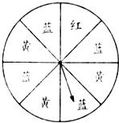

# Mathematics (Grade 5)

**ID**: 4507980f
**难度**: medium_hard
**题型**: multiple_choice

## 题目
转转盘．指针转动后，停在红色区域的可能性是（  ）
$\begin{description}
\item A．\frac{3}{4}\item B．\frac{1}{4}\item C．\frac{1}{8}
\end{description}$

## 解答

**答案**: C

1. Step1:观察转盘图可知，大转盘被平均分成了8份
2. Step2:确定红色区域占其中的1份
3. Step3:根据求一个数是另一个数的几分之几用除法，计算停在红色区域的可能性为1÷8
4. Step4:得出1÷8的结果为$rac{1}{8}$

## 知识点

**知识点**:
  - 简单事件发生的可能性求解．

---
