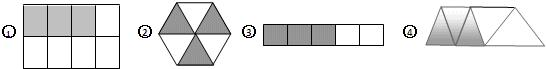

# Mathematics (Grade 5)

**ID**: 45324e7a
**难度**: medium_hard
**题型**: multiple_choice

## 题目
图形中的阴影部分可以用$\frac{3}{5}$表示(  )

A．①
B．②
C．③
D．④

## 解答

**答案**: C

1. Step1:分析图①，将长方形面积看作单位‘1’，平均分成8份，涂色部分占3份，其用分数表示为$\frac{3}{8}$
2. Step2:分析图②，把正六边形面积看作单位‘1’，平均分成6份，涂色部分占3份，用分数表示为$\frac{3}{6}$，即$\frac{1}{2}$
3. Step3:分析图③，将长方形面积看作单位‘1’，平均分成5份，涂色部分占3份，用分数表示为$\frac{3}{5}$
4. Step4:分析图④，把梯形的面积分成5份，但不是‘平均分’，所以涂色部分不能用$\frac{3}{5}$表示
5. Step5:根据以上分析，只有图③中的阴影部分可以用$\frac{3}{5}$表示，所以答案选C

## 知识点

**知识点**:
  - 分数的意义、读写及分类．

---
