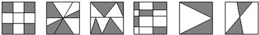

# Mathematics (Grade 5)

**ID**: 47a7f8a9
**难度**: medium_hard
**题型**: multiple_choice

## 题目
各图中的阴影部分，能用分数$\frac{1}{2}$表示的有（  ）个．

A．1个
B．2个
C．3个
D．4个

## 解答

**答案**: C

1. Step1:明确分数的意义，即将单位“1”平均分成若干份，表示其中这样一份或几份数称为分数
2. Step2:把图（1）当做单位“1”，观察发现其阴影部分不能表示成$\frac{1}{2}$
3. Step3:把图（2）当做单位“1”，观察发现其阴影部分能表示成$\frac{1}{2}$
4. Step4:把图（3）当做单位“1”，观察发现其阴影部分能表示成$\frac{1}{2}$
5. Step5:把图（4）当做单位“1”，观察发现其阴影部分不能表示成$\frac{1}{2}$
6. Step6:把图（5）当做单位“1”，观察发现其阴影部分能表示成$\frac{1}{2}$
7. Step7:把图（6）当做单位“1”，观察发现其阴影部分不能表示成$\frac{1}{2}$
8. Step8:统计能表示成$\frac{1}{2}$的图形个数为3个

## 知识点

**知识点**:
  - 分数的意义、读写及分类．

---
